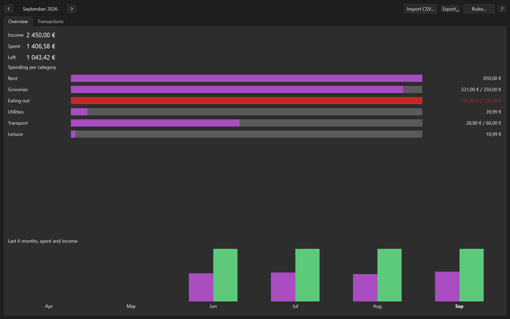
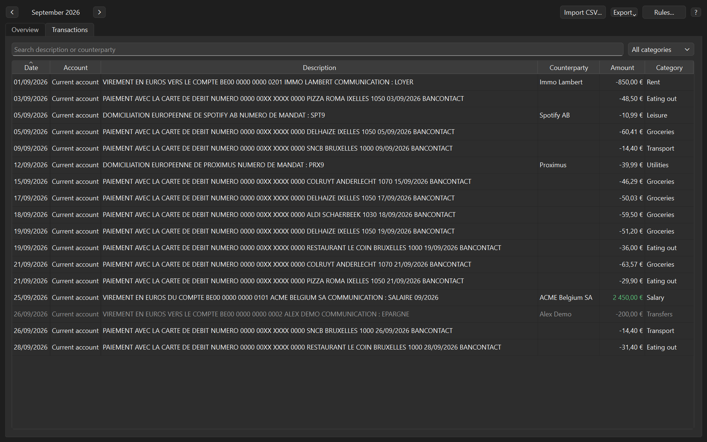
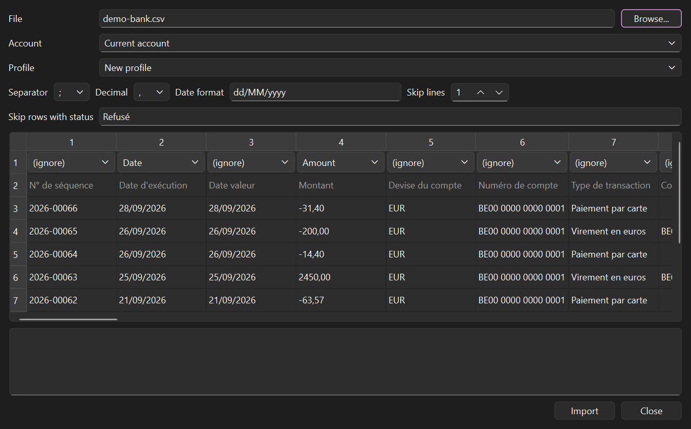
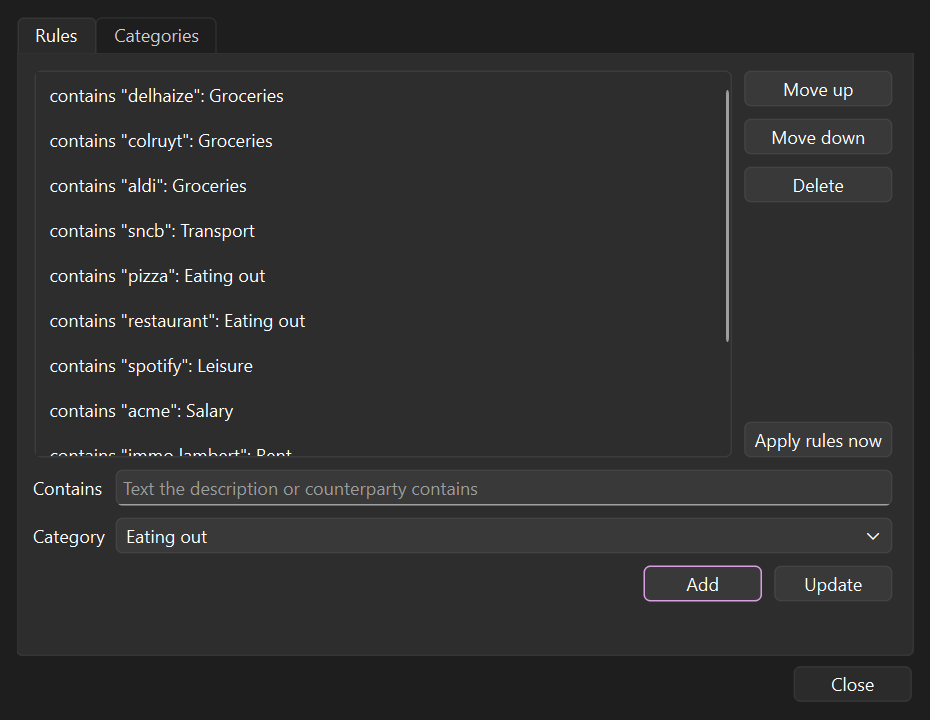

# Carnet

A desktop budget app for Windows. It imports the CSV file your bank lets you export, sorts every
transaction into a category with rules you write, and shows where your money went each month against
the budgets you set. Everything stays in one SQLite file on your computer.



## Features

- **Import any bank's CSV.** You map the columns once and Carnet saves the mapping as a profile. When it
  recognizes the column names (French, Dutch or English), it fills the mapping in for you. Files in
  UTF-8 or Windows-1252 both work, and rows with a status like "Refused" can be skipped.
- **Import the same file twice without duplicates.** Each transaction is identified by its account,
  date, amount and description, and two identical coffees on the same day still count as two.
- **Categorize with rules.** "Contains *delhaize* -> Groceries", tried in the order you set, ignoring case
  and accents. Picking a category by hand in the table always wins over the rules.
- **Keep transfers out of the totals.** Money moved between your own accounts shows in grey and never
  counts as income or spending.
- **See the month at a glance.** Income, spent and what is left, spending per category against its
  budget (red past 100%), and six months of spending next to income.
- **Export** a month's summary or its transactions as CSV that opens directly in Excel.
- Remembers the window and the month you were on, with keyboard shortcuts for moving between months
  (Ctrl+PgUp, Ctrl+PgDown, Ctrl+Home).

| Transactions | Import | Rules |
| --- | --- | --- |
|  |  |  |

## Try it

Build it (below), start `carnet.exe`, click **Import CSV...** and open
[`docs/demo/demo-bank.csv`](docs/demo/demo-bank.csv). It is a made-up export in the layout of a Belgian
bank: Carnet suggests every column and the refused payment to skip, so you only press **Import** and
name the profile. Then add a few rules under **Rules...** (for example *delhaize* -> Groceries) and set
budgets in the Categories tab.

## Building on Windows

You need Visual Studio 2026 with the C++ workload, CMake 3.25 or newer, Qt 6 (the MSVC 64-bit kit, from
the Qt online installer) and [vcpkg](https://github.com/microsoft/vcpkg), which provides SQLite and
GoogleTest.

A Developer PowerShell for VS 2026 sets `VCPKG_ROOT` to the vcpkg that ships with Visual Studio. To
point at your own vcpkg checkout and your Qt install, create a `CMakeUserPresets.json` next to
`CMakePresets.json` (it is gitignored):

```json
{
  "version": 6,
  "configurePresets": [
    {
      "name": "local",
      "inherits": "windows-msvc",
      "environment": { "VCPKG_ROOT": "C:/path/to/vcpkg" },
      "cacheVariables": { "CMAKE_PREFIX_PATH": "C:/Qt/6.12.0/msvc2022_64" }
    }
  ],
  "buildPresets": [{ "name": "local", "configurePreset": "local" }],
  "testPresets": [{ "name": "local", "configurePreset": "local", "output": { "outputOnFailure": true } }]
}
```

Then, from a Developer PowerShell for VS 2026:

```
cmake --preset local
cmake --build --preset local
ctest --preset local
```

`build/local/app/carnet.exe` runs straight from the build folder. In CLion, pick the Visual Studio
toolchain and the preset.

### A folder to share

The `windows-msvc-release` preset (add a `local-release` preset inheriting it, as above, if you use your
own vcpkg) builds an optimized version, and `cmake --install` gathers `carnet.exe` with the Qt and SQLite
libraries it needs into `build/install`, ready to zip. The target PC needs the Microsoft Visual C++
Redistributable, which most Windows installs already have.

```
cmake --preset local-release
cmake --build --preset local-release
cmake --install build/local-release
```

The screenshots above come from the demo file. To regenerate them after a UI change, configure with
`-DCARNET_BUILD_SCREENSHOTS=ON`, build the `carnet_screenshots` target and run it: it draws the real
windows without showing them and writes `docs/screenshots/*.png`.

## How it is built

- **Two layers.** `core/` is a plain C++23 library with no Qt in it: amount, date and CSV parsing, import
  profiles, deduplication, rules, the monthly totals and the CSV export. `app/` is the Qt Widgets
  interface on top of it, using Qt's model/view classes.
- **Errors are values.** Parsers return `std::expected<T, ParseError>`, so a bad row in a bank file is
  reported with its line number instead of throwing. Only real storage failures throw, and the UI turns
  them into a message.
- **Money is an integer count of cents** from the moment it is parsed. It never passes through a
  floating-point number.
- **SQLite with numbered migrations.** The schema version lives in `PRAGMA user_version`, and each
  migration runs once in a transaction. Foreign keys are on for every connection, and the monthly
  totals are SQL queries.
- **Hand-drawn charts.** The bars and the six-month chart are small `QPainter` widgets instead of the Qt
  Charts module.
- **Tested.** GoogleTest covers the core, including a month whose totals were worked out by hand, and
  Qt Test covers the models, widgets and windows (settings, shortcuts, export). The Qt tests run
  offscreen and never touch your real data folder.

## License notes

Carnet links Qt dynamically under the LGPL v3 and uses SQLite, which is in the public domain.
